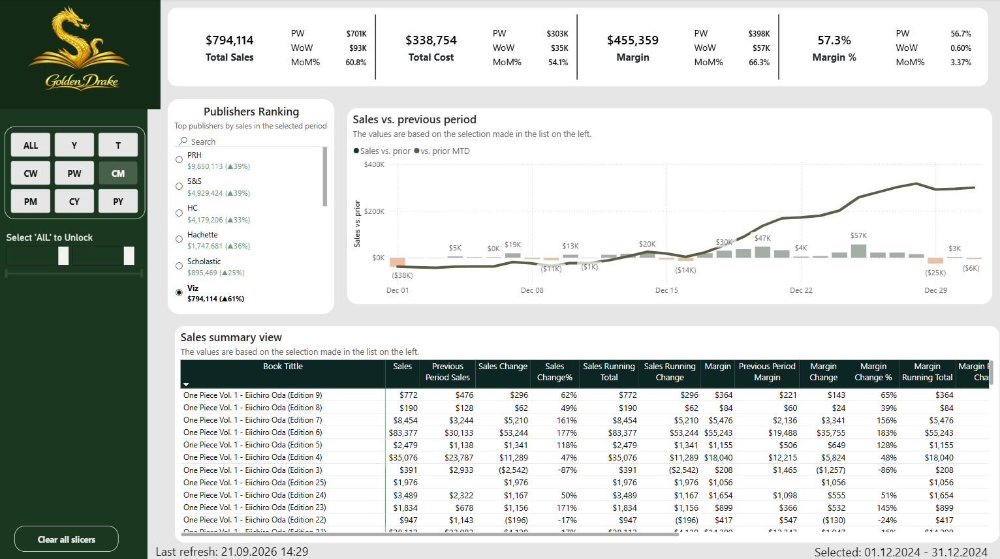
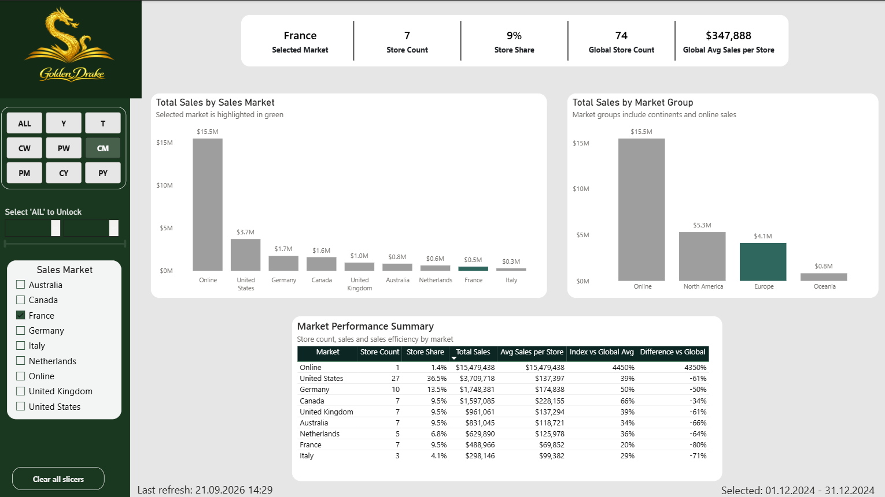
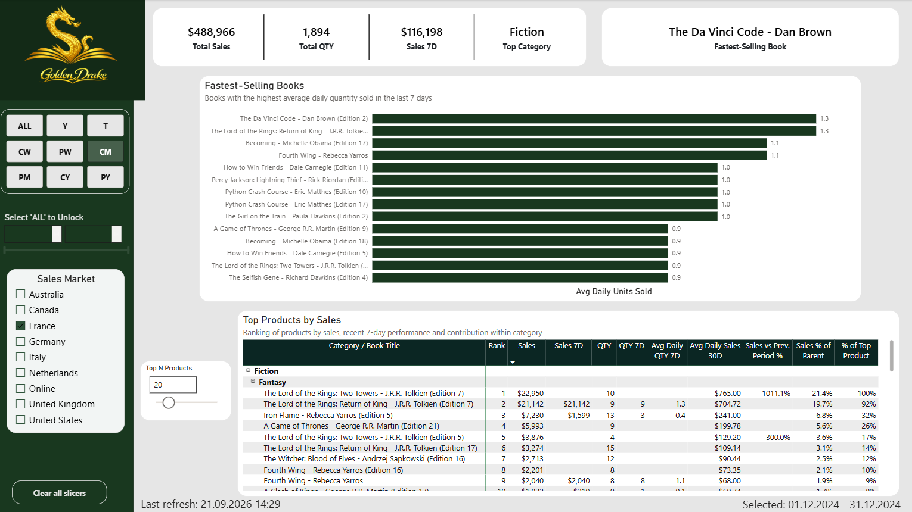
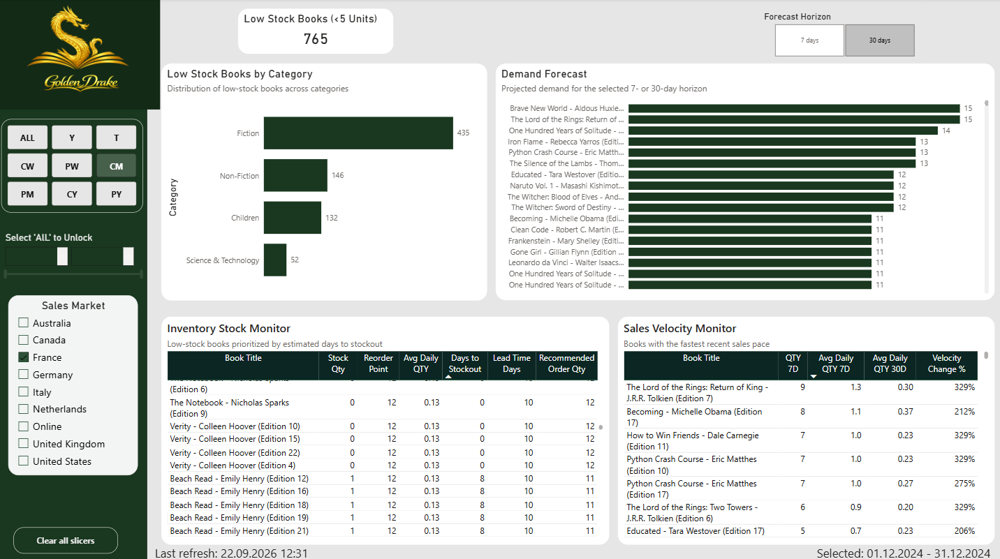
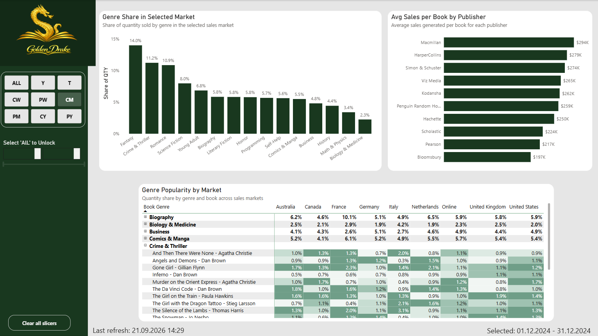
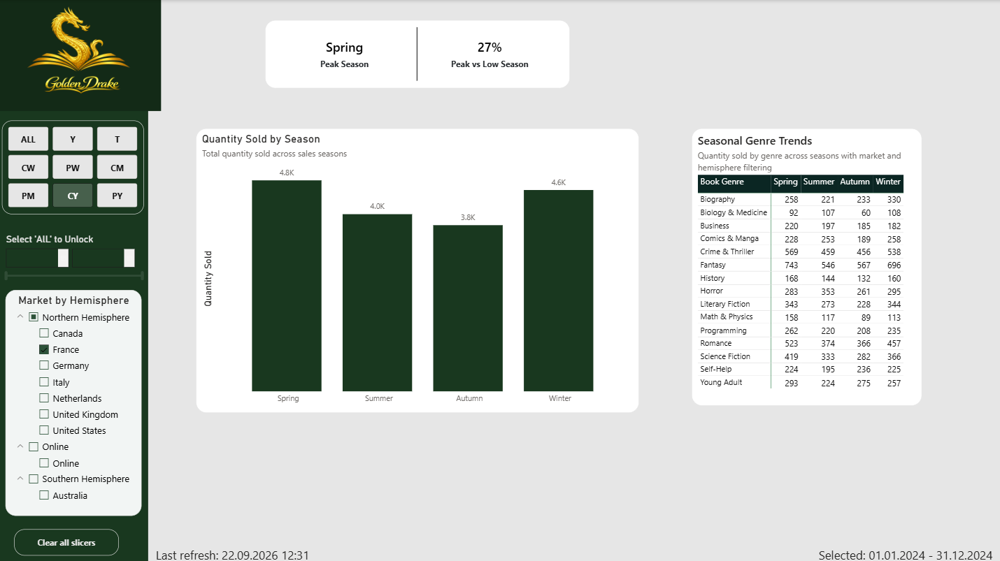
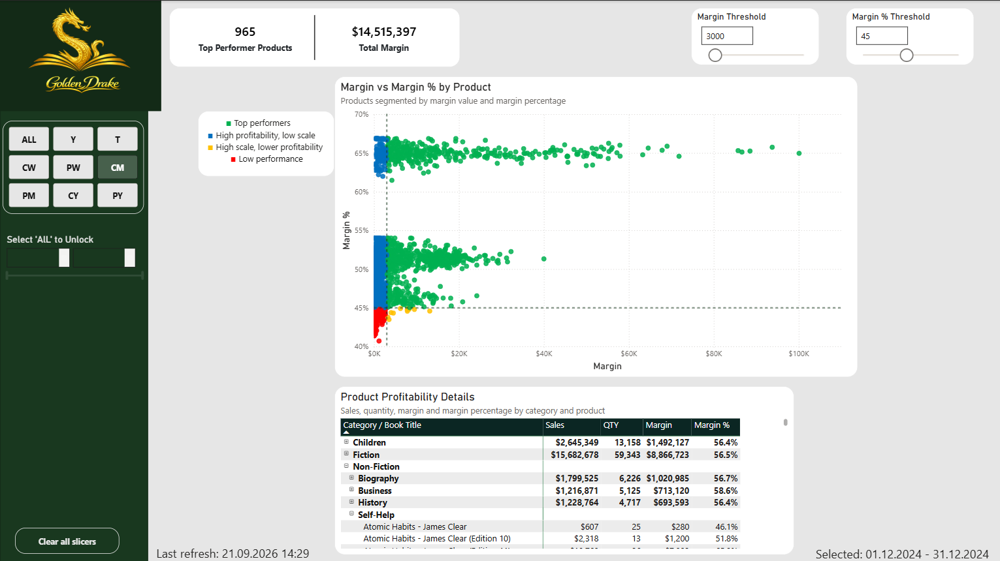
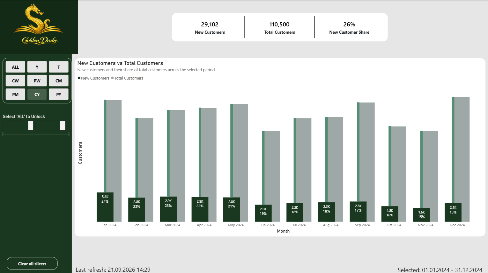

# GoldenDrake Bookstore - Dashboard Power BI

[English version](README.md)

[Zobacz interaktywny dashboard Power BI](https://app.fabric.microsoft.com/view?r=eyJrIjoiNjVhNjQ1MjktYTEzZS00ZTU5LWI2NTUtOWIxZWNiYTJiNDc1IiwidCI6IjI3ZWI2YjZjLWRhZWQtNDFkMS05NTJhLTM0ZDY0MjgzZWFhNSJ9&embedImagePlaceholder=true)

## Opis projektu

GoldenDrake Bookstore to fikcyjna księgarnia działająca na wielu rynkach sprzedażowych.

Projekt Power BI koncentruje się na analizie wyników sprzedaży, porównaniu rynków, monitorowaniu zapasów, planowaniu popytu, popularności gatunków, sezonowości, rentowności produktów oraz pozyskiwaniu nowych klientów.

Głównym celem projektu było stworzenie interaktywnego raportu analitycznego wspierającego monitorowanie sprzedaży oraz identyfikację produktów i rynków, które mogą wymagać działań związanych z zapasami, zamówieniami lub innymi decyzjami biznesowymi.

## Kontekst biznesowy

GoldenDrake Bookstore działa na wielu rynkach i potrzebuje uporządkowanego sposobu monitorowania sprzedaży, poziomu zapasów oraz wyników produktów.

Główne wyzwania biznesowe obejmują:

* porównywanie wyników sprzedaży pomiędzy rynkami,
* monitorowanie poziomu zapasów i identyfikowanie produktów z niskim stanem magazynowym,
* ograniczanie ryzyka braków magazynowych i anulowania zamówień,
* wspieranie decyzji dotyczących uzupełniania zapasów i planowania popytu,
* analizę różnic w popularności gatunków pomiędzy rynkami,
* identyfikowanie sezonowych wzorców popytu,
* ocenę rentowności produktów,
* monitorowanie pozyskiwania nowych klientów.

## Cele analizy

Raport został zaprojektowany tak, aby odpowiadać między innymi na następujące pytania biznesowe:

* Które książki generują najwyższą sprzedaż?
* Które produkty sprzedają się obecnie najszybciej?
* Które produkty mają niski poziom zapasów?
* Które produkty mogą wymagać ponownego zamówienia?
* Jaki jest prognozowany popyt na kolejne 7 lub 30 dni?
* Jak wyniki sprzedaży różnią się pomiędzy rynkami?
* Jak efektywne są poszczególne rynki w porównaniu ze średnią globalną?
* Które gatunki książek są najpopularniejsze na poszczególnych rynkach?
* Którzy wydawcy generują najwyższą średnią sprzedaż na książkę?
* Jak sezonowość wpływa na sprzedaż i popyt na poszczególne gatunki?
* Które produkty generują najwyższą marżę?
* Jak liczba i udział nowych klientów zmieniają się w czasie?

## Strony raportu

### 1. Overview

Strona Overview przedstawia ogólne podsumowanie wyników biznesowych.

Zawiera:

* Total Sales,
* Total Cost,
* Margin,
* Margin %,
* ranking wydawców,
* porównanie sprzedaży z poprzednim okresem,
* szczegółową analizę sprzedaży i marży według produktu.

### 2. Market Performance

Strona porównuje wyniki sprzedaży pomiędzy poszczególnymi rynkami oraz większymi grupami rynków.

Zawiera:

* wybrany rynek,
* liczbę sklepów i udział sklepów,
* globalną liczbę sklepów,
* globalną średnią sprzedaż na sklep,
* całkowitą sprzedaż według rynku,
* całkowitą sprzedaż według grupy rynków,
* porównanie średniej sprzedaży na sklep ze średnią globalną.

Wybrany rynek jest wyróżniany na wizualizacjach, co ułatwia porównanie jego wyników z pozostałymi rynkami.

### 3. Top Products

Strona koncentruje się na wynikach produktów oraz ich najnowszej aktywności sprzedażowej.

Zawiera:

* Total Sales,
* Total QTY,
* Sales 7D,
* Top Category,
* Fastest-Selling Book,
* ranking książek według średniej dziennej liczby sprzedanych egzemplarzy,
* szczegółowy ranking Top N produktów,
* wyniki sprzedaży z ostatnich 7 dni,
* udział produktu w sprzedaży swojej kategorii.

### 4. Inventory & Demand Planning

Strona wspiera monitorowanie zapasów oraz krótkoterminowe planowanie popytu.

Zawiera:

* Low Stock Books (<5 Units),
* liczbę książek z niskim stanem magazynowym według kategorii,
* prognozowany popyt dla wybranego horyzontu 7 lub 30 dni,
* Inventory Stock Monitor,
* szacowaną liczbę dni do wyczerpania zapasu,
* Reorder Point,
* Lead Time Days,
* Recommended Order Qty,
* Sales Velocity Monitor,
* porównanie aktualnego tempa sprzedaży ze średnim tempem z ostatnich 30 dni.

Tabela zapasów jest uporządkowana według szacowanej liczby dni do wyczerpania zapasu, dzięki czemu najbardziej pilne produkty są widoczne jako pierwsze.

### 5. Genre & Publisher Insights

Strona porównuje popularność gatunków oraz wyniki wydawców.

Zawiera:

* udział gatunków na wybranym rynku,
* średnią sprzedaż na książkę według wydawcy,
* porównanie popularności gatunków pomiędzy wszystkimi rynkami sprzedażowymi,
* możliwość przejścia z poziomu gatunku do pojedynczych tytułów książek.

Macierz wykorzystuje formatowanie warunkowe, aby ułatwić identyfikowanie różnic w popularności gatunków i książek pomiędzy rynkami.

### 6. Seasonality & Genre Trends

Strona analizuje sezonowe wzorce sprzedaży oraz różnice w popycie na poszczególne gatunki.

Zawiera:

* Peak Season,
* Peak vs Low Season,
* liczbę sprzedanych egzemplarzy według sezonu,
* sezonowe wyniki poszczególnych gatunków,
* filtrowanie według rynku i półkuli.

Filtr półkuli umożliwia prawidłową interpretację sezonowości dla rynków znajdujących się na półkuli północnej i południowej.

### 7. Product Profitability

Strona analizuje produkty na podstawie wartości marży oraz procentowej marży.

Zawiera:

* Top Performer Products,
* Total Margin,
* dynamiczny Margin Threshold,
* dynamiczny Margin % Threshold,
* segmentację produktów na cztery grupy rentowności,
* szczegółową analizę sprzedaży, ilości, marży i Margin %.

Produkty klasyfikowane są jako:

* Top performers,
* High profitability, low scale,
* High scale, lower profitability,
* Low performance.

### 8. Customer Growth

Strona analizuje pozyskiwanie nowych klientów w czasie.

Zawiera:

* New Customers,
* Total Customers,
* New Customer Share,
* porównanie liczby nowych klientów z całkowitą liczbą klientów w wybranym okresie.

Poziom szczegółowości osi czasu zmienia się dynamicznie w zależności od wybranego okresu, umożliwiając analizę danych w ujęciu dziennym, tygodniowym, miesięcznym oraz długoterminowym.

## Dane i model

Model danych opiera się na tabelach faktów i wymiarów.

### Tabele faktów

**fSales** - zawiera transakcje sprzedażowe, w tym produkty, ilości, wartości sprzedaży, koszty, marże, klientów oraz daty transakcji.

**fInventory** - zawiera informacje o zapasach, w tym aktualną ilość zapasu, punkt ponownego zamówienia, czas realizacji oraz średnią tygodniową sprzedaż.

### Tabele wymiarów

**dProduct** - zawiera informacje o książkach, kategoriach, gatunkach, wydawcach oraz innych atrybutach produktów.

**dStore** - zawiera informacje o sklepach, krajach, rynkach sprzedażowych oraz grupach rynków.

**dDate** - zawiera dane kalendarzowe wykorzystywane w analizach czasowych oraz filtrowaniu okresów.

Dane zostały załadowane z Lakehouse w Microsoft Fabric, a następnie przekształcone w Power Query.

## Kluczowe miary i logika

Raport wykorzystuje miary DAX i obliczenia związane między innymi z:

* Total Sales, Total Cost, Margin i Margin %,
* Sales 7D i QTY 7D,
* średnią dzienną liczbą sprzedanych egzemplarzy dla bieżącego i 30-dniowego okresu,
* aktualnym poziomem zapasów,
* identyfikacją produktów z niskim stanem magazynowym,
* Days to Stockout,
* Recommended Order Qty,
* prognozowanym popytem dla horyzontu 7 i 30 dni,
* tempem sprzedaży oraz zmianą tempa sprzedaży,
* udziałem gatunków i książek według rynku,
* średnią sprzedażą na książkę według wydawcy,
* Peak Season oraz Peak vs Low Season,
* segmentacją rentowności produktów,
* liczbą nowych klientów oraz New Customer Share.

## Wykorzystane narzędzia

* Power BI
* Power Query
* DAX
* Microsoft Fabric
* Lakehouse

## Status projektu

Projekt portfolio został ukończony.

Finalny raport zawiera osiem interaktywnych stron analitycznych obejmujących sprzedaż, wyniki rynków, produkty, zapasy, popyt, popularność gatunków, sezonowość, rentowność oraz pozyskiwanie nowych klientów.

Interaktywna wersja raportu jest dostępna w Power BI Service.
